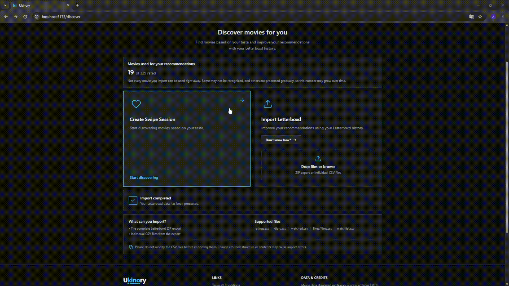
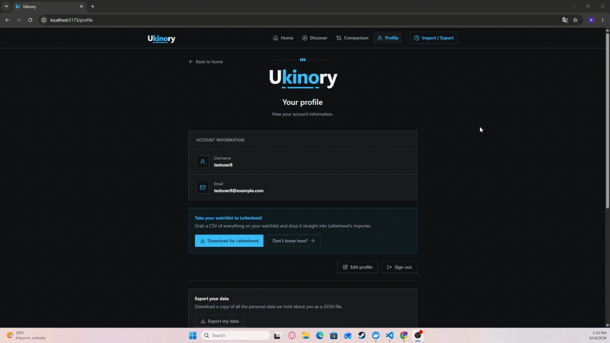
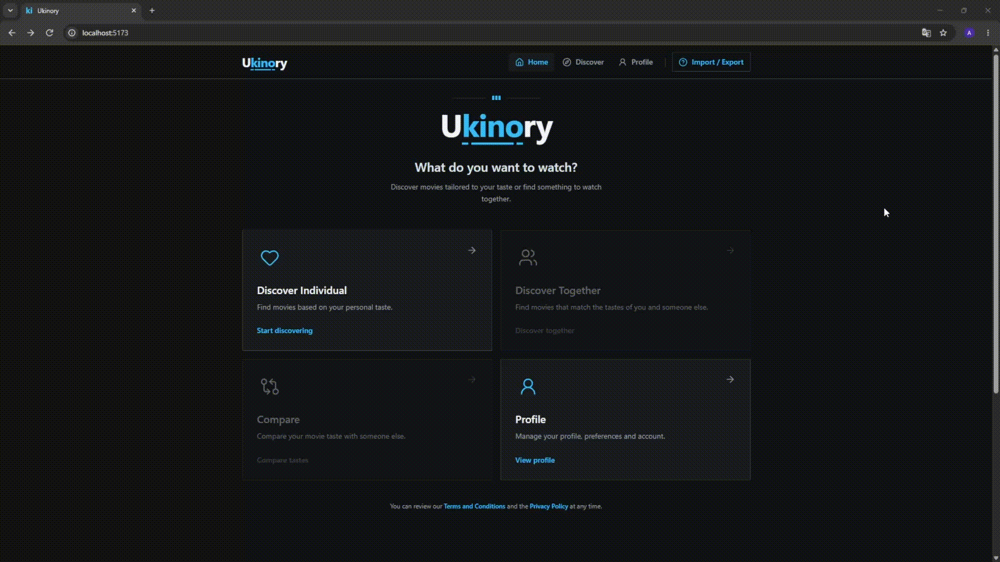
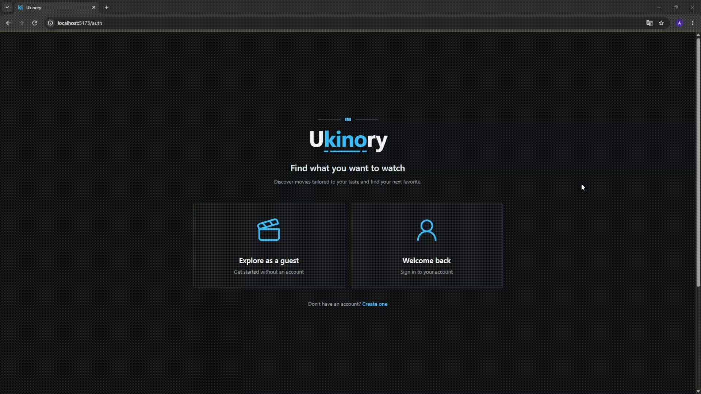
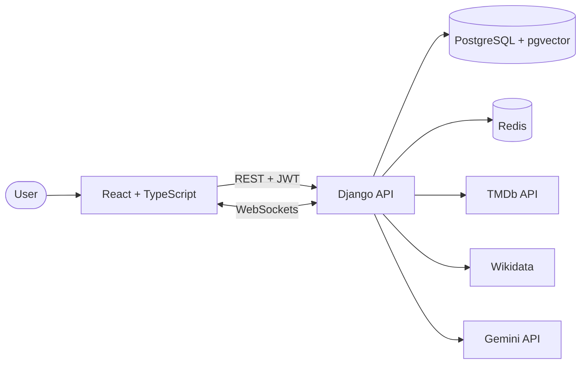

# Ukinory

**Movie taste analysis and collaborative movie discovery, built on your Letterboxd data.**

**[Live demo](https://ukinory.vercel.app)** · [Documentation](#documentation) · [Run it locally](docs/development.md)

[](https://github.com/xultimatex8/ukinory/actions/workflows/ci.yml)

<table>
  <tr>
    <td></td>
    <td></td>
  </tr>
  <tr>
    <td></td>
    <td></td>
  </tr>
</table>

Import your Letterboxd history and Ukinory builds an AI-written taste profile, recommends
movies you haven't seen, and lets you compare tastes with a friend or swipe through
recommendations together in real time.

## Features

- **Guest or registered use.** Start immediately as a guest and claim an account later without losing any data.
- **Letterboxd import.** Upload your official Letterboxd export; each film is matched to TMDb and enriched with Wikidata metadata.
- **Taste profile.** An LLM-written narrative about what you like, generated from your ratings and movie embeddings.
- **Taste comparison.** Invite another person with a shareable, expiring link and get compatibility metrics, a narrative about the pair and joint recommendations.
- **Swipe discovery.** Tinder-style movie cards with personalized recommendations combining content-based filtering, collaborative filtering and swipe behavior.
- **Letterboxd-compatible export.** Download the movies you added as a CSV to import back into Letterboxd.
- **Data rights.** Export all your data as JSON or delete your account at any time.

### Planned Features

- **Paired swipe.** Two people swipe the same recommendations live; when both add a movie to their watchlist, it's a match.
- **Rating prediction.** Machine learning models predict how you'd rate unwatched movies and improve with your swipes.

## Code Quality

<!-- SONAR-METRICS:START -->
| Metric | Value |
|---|---:|
| Coverage | N/A |
| Bugs | N/A |
| Vulnerabilities | N/A |
| Code smells | N/A |
| Duplicated lines | N/A |
| Lines of code | N/A |
| Quality Gate | N/A |
<!-- SONAR-METRICS:END -->

## How it works



1. **Import.** The Letterboxd export is parsed and each film is matched to a TMDb id by title and year.
2. **Enrich.** Metadata is fetched from Wikidata in batches and cached per movie.
3. **Embed.** Gemini generates a semantic embedding per movie, stored in pgvector. Only the films that drive your recommendations are embedded during the import; the rest are processed asynchronously.
4. **Recommend.** Candidates are ranked with vector search, combined with collaborative filtering and a per-user rating-prediction model.
5. **Explain.** An LLM writes the taste profile and a short justification for each recommendation.

The full walkthrough is in [the import flow](docs/letterboxd-export-import-flow.md).

## Technical highlights

- **Fast imports at any library size.** Embeddings are computed synchronously only for the top films by rating and likes, and the long tail goes through Gemini's batch API in the background. Import latency stays roughly constant instead of growing with library size.
- **Idempotent embeddings.** Each movie's embedding text is hashed, so re-imports and pipeline changes only recompute what actually changed.
- **Resilient external APIs.** TMDb and Wikidata calls are batched, paced and retried. A film with no match is recorded and the import continues; a systemic outage stops matching instead of hammering a failing API.
- **Shared pacing and spend guardrails.** A Redis Lua script paces TMDb, Wikidata and Gemini embedding calls across all processes, and per-client daily and weekly budgets cap Gemini spend. Narrative generation reserves its cost up front and reconciles it against actual token usage.
- **Guest-to-account without migration.** Guests and registered users share the same `User` row, so claiming an account is a single update.
- **Cached comparisons with a privacy boundary.** Comparison results are cached by a hash of both libraries. Only a `public` subset of the metrics is returned by the API; the `internal` part only feeds the LLM prompt.
- **Real-time rooms.** Comparison rooms and paired swipe sessions use WebSockets.

## Tech stack

| Layer | Technology |
|---|---|
| Backend | Django |
| AI / ML | Python, Gemini API (embeddings and text) |
| Database | PostgreSQL + pgvector |
| Cache / real-time / queue | Redis, WebSockets, RQ |
| Frontend | React (Vite) + TypeScript |
| Styling | Tailwind CSS |
| Data sources | TMDb, Wikidata |
| Infrastructure | Docker Compose, GitHub Actions (CI/CD), SonarQube (static analysis), Render, Vercel, Neon |

Rationale for each choice: [docs/tech-stack.md](docs/tech-stack.md).

## Testing and CI

Everything runs on [GitHub Actions](https://github.com/xultimatex8/ukinory/actions).

- **CI** (`ci.yml`, on every pull request and push to `main`) runs three parallel jobs:
  - *Backend*: Django system checks and the `pytest` suite, against real PostgreSQL + pgvector and Redis service containers.
  - *Frontend*: runs the test suite, lint and production build.
  - *Docker Compose*: validates the Compose file, builds the images, starts the stack and waits for the backend health check.
- **Secrets scan** (`secrets-scan.yml`): Gitleaks on every push and pull request, plus a weekly full run.
- **CD** (`cd.yml`): publishing a GitHub release deploys the backend to Render and the frontend to Vercel.
- **Scheduled jobs**: catalog seeding, embedding batch sync and the cleanup of stale guests, rooms, sessions, invites and import jobs run as scheduled workflows that call Django management commands against production. The import queue is processed the same way, by an RQ worker in burst mode that runs hourly and can also be dispatched by the backend on demand, so no always-on worker is needed.
- **Static analysis:** SonarQube Community Build can be run locally through Docker Compose to inspect code quality and review analysis results, including backend test coverage. It is separate from the GitHub Actions CI pipeline.

See [docs/development.md](docs/development.md#tests) for how to run the tests locally, and [docs/development.md](docs/development.md#sonarqube) for local SonarQube analysis.

## Quick start

You only need [Git](https://git-scm.com/downloads) and [Docker Desktop](https://www.docker.com/products/docker-desktop/).

```bash
git clone https://github.com/xultimatex8/ukinory.git
cd ukinory
cp .env.example .env        # then fill in the values (Windows: Copy-Item .env.example .env)
docker compose up -d --build
```

- Frontend: http://localhost:5173
- Backend: http://localhost:8000

You'll need a [TMDb API key](https://www.themoviedb.org/settings/api) and a [Gemini API key](https://aistudio.google.com/apikey).
Environment variables, migrations, day-to-day workflow and Jupyter are covered in the
[development guide](docs/development.md).

## Documentation

| Document | What's in it |
|---|---|
| [Tech stack](docs/tech-stack.md) | Technologies and why they were chosen |
| [Functional requirements](docs/mvp-functional-requirements.md) | What the MVP does, requirement by requirement |
| [Data model](docs/data-model.md) | Entities, relationships, design notes and requirement traceability |
| [Letterboxd import flow](docs/letterboxd-export-import-flow.md) | End-to-end walkthrough of the import and embedding pipeline |
| [Development guide](docs/development.md) | Local setup, environment variables, Jupyter, tests and SonarQube static analysis |

## Known constraints

- **Letterboxd has no usable API for this project**, and scraping is against their terms. Ukinory relies on the export that users download from their own account, so syncing back to Letterboxd is always a manual CSV round trip.
- **Ukinory doesn't recreate Letterboxd's paid statistics.** The taste metrics are only used as input for the generated narrative and are never shown as stats or charts.
- **Guest sessions can't be recovered.** If a guest loses their browser storage before claiming an account, the data is unreachable; inactive guest data is deleted automatically.

## Credits

This product uses the TMDb API but is not endorsed or certified by TMDb. Ukinory is not
affiliated with Letterboxd.

Built by [Alejandro González Macías](https://github.com/xultimatex8) ·
[LinkedIn](https://linkedin.com/in/alejandro-gonzalez-macias-agm)