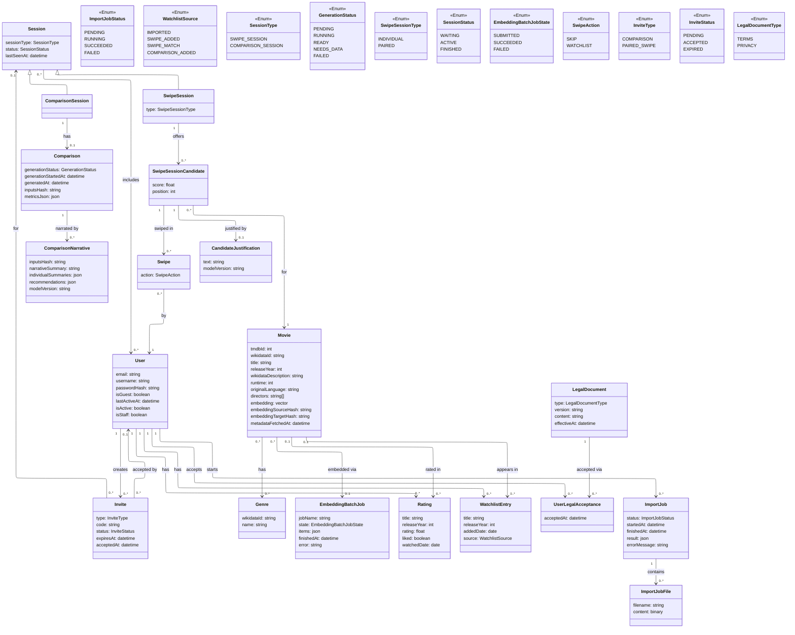

# Data Model — Ukinory

This document describes the core entities of Ukinory and how they relate to each other.

## How to read this document

The entities fall into six groups:

| Group | Entities |
|---|---|
| Accounts | `User`, `LegalDocument`, `UserLegalAcceptance` |
| Movie catalog | `Movie`, `Genre`, `EmbeddingBatchJob` |
| User data | `Rating`, `WatchlistEntry`, `ImportJob`, `ImportJobFile` |
| Invites and rooms | `Invite`, `Session`, `ComparisonSession` |
| Comparison | `Comparison`, `ComparisonNarrative` |
| Swiping | `SwipeSession`, `SwipeSessionCandidate`, `Swipe`, `CandidateJustification` |

Conventions used below:

- Surrogate ids, `createdAt`/`updatedAt` timestamps and foreign-key columns are omitted from the
  diagram; arrows imply them (see the first design note).
- The traceability matrix at the end maps each backend requirement to the entities it touches.

## Diagram

## Entities

**User** — a guest or a registered account, distinguished by `isGuest`. `email` is unique and nullable; `username` is unique (guests get an auto-generated `guest_<random>`); accounts without a password get an unusable one. A check constraint (`guest_users_have_no_email`) forbids guests having an `email`. `lastActiveAt` records the last activity; `isActive` and `isStaff` are standard Django auth flags.

**LegalDocument** — a versioned Terms or Privacy text (`type`, `version`, `content`, `effectiveAt`). Rows are immutable: saving an existing row raises an error, so a change means a new row. `(type, version)` and `(type, effectiveAt)` are each unique.

**UserLegalAcceptance** — a `User` accepting a `LegalDocument` at `acceptedAt`. Unique per `(user, document)`; the document relation is `PROTECT`, the user relation cascades.

**Invite** — a shareable code (`code`, unique) with `type`, `status`, `expiresAt` and `acceptedAt`. It belongs to an `inviter` (`User`), optionally records who accepted it (`accepted by`, `User`), and optionally points at a `Session` (the room it opens). An invite is expired when `expiresAt` is in the past.

**Session** — the base for rooms: `sessionType`, `status` (default `WAITING`), `lastSeenAt` and a many-to-many `users`. `ComparisonSession` and `SwipeSession` extend it.

**ComparisonSession** — a `Session` with no extra columns; has at most one `Comparison`.

**Comparison** — one-to-one with its `ComparisonSession`. Holds `generationStatus` (default `PENDING`), `generationStartedAt`, `generatedAt`, `inputsHash` and `metricsJson`.

**ComparisonNarrative** — LLM output for a `Comparison` at a given `inputsHash`: `narrativeSummary`, `individualSummaries` (JSON), `recommendations` (JSON list) and `modelVersion`. A `Comparison` can have many.

**SwipeSession** — a `Session` with an extra `type` (`INDIVIDUAL` or `PAIRED`). Offers many `SwipeSessionCandidate`.

**SwipeSessionCandidate** — a `Movie` offered in a `SwipeSession`, with `score` and `position`. Unique per `(session, movie)` and per `(session, position)`; ordered by `position`.

**CandidateJustification** — one-to-one with a `SwipeSessionCandidate`: `text` and `modelVersion`.

**Swipe** — a `User`'s `action` (`SKIP` or `WATCHLIST`) on a `SwipeSessionCandidate`. Unique per `(user, candidate)`; indexed on `(user, action)`.

**Movie** — identified by `tmdbId` (unique), with an optional unique `wikidataId`. Stores `title`, `releaseYear`, `wikidataDescription`, `runtime`, `originalLanguage`, `directors` (JSON) and `metadataFetchedAt`. `embedding` is a 768-dimension vector with an HNSW cosine index; `embeddingSourceHash` and `embeddingTargetHash` track what it was built from. `embeddingBatch` optionally points at the `EmbeddingBatchJob` that produced it. Many-to-many with `Genre`.

**Genre** — `name` and an optional unique `wikidataId`.

**EmbeddingBatchJob** — a submitted batch-embedding job: `jobName` (unique), `state` (`SUBMITTED`/`SUCCEEDED`/`FAILED`), `items` (JSON), `finishedAt` and `error`.

**Rating** — a `User`'s entry for a film: `title`, `releaseYear`, optional `movie` (nullable, `SET_NULL`), `rating` (nullable), `liked` and `watchedDate`. Unique per `(user, title, releaseYear)`.

**WatchlistEntry** — a film a `User` wants to watch: `title`, `releaseYear`, optional `movie`, `addedDate` and `source` (`IMPORTED`, `SWIPE_ADDED`, `SWIPE_MATCH`, `COMPARISON_ADDED`). Unique per `(user, title, releaseYear)`.

**ImportJob** — an import run by a `User`: `status` (`PENDING` → `RUNNING` → `SUCCEEDED`/`FAILED`), `createdAt`, `startedAt`, `finishedAt`, `result` (JSON) and `errorMessage` (truncated to 2000 characters).

**ImportJobFile** — an uploaded file of an `ImportJob`: `filename` and binary `content`.

## Design notes

- **Surrogate `id` keys, `createdAt`/`updatedAt` timestamps and stored foreign keys are omitted from the class bodies.** Every entity is assumed to have a primary key, and every relationship drawn as an arrow is assumed to be backed by the foreign key(s) needed to implement it (e.g. the `SwipeSession "1" --> "0..*" SwipeSessionCandidate` arrow implies a `sessionId` column on `SwipeSessionCandidate`). The one exception is `Swipe "0..*" --> "1" User : by`, which records which participant made a given swipe. What is kept as an attribute is what is load-bearing for a requirement and not implied by an arrow: `User.lastActiveAt` (drives the FR-B10 cleanup job), `Invite.expiresAt` (drives FR-B13), `Comparison.generatedAt` (freshness), `LegalDocument.effectiveAt` and `UserLegalAcceptance.acceptedAt` (FR-B09's versioning). `CandidateJustification` has no dedicated generation timestamp; it relies on the inherited `createdAt`.

- **`User.isGuest`** is the entire guest/registered distinction — every other entity (`Rating`, `WatchlistEntry`, `Comparison`, `SwipeSession`, etc.) references a plain `User` and behaves identically either way. This is what makes "claiming" an account a one-row update instead of a data migration.

- **`Invite`** decouples "how two people find each other" from what happens once they do — the same entity covers both comparisons and paired swipe sessions via `type`, and expiring unused invites (`status: EXPIRED`) keeps stale codes from being usable indefinitely. For comparisons the invite points at an already-existing `WAITING` room (`session`), created in the same transaction as the invite. Short TTL (5 min), a cap of 20 pending invites per user, and a row lock on acceptance keep codes single-use and bounded.

- **`Movie.embedding`** is computed once per movie from its stored fields (`title`, `wikidataDescription`, `genres`, `directors`, `originalLanguage`) and reused across all users — no per-user recalculation. `posterUrl`, `voteAverage` and streaming-provider availability are fetched from TMDb at display time rather than cached on `Movie`. `embeddingSourceHash`/`embeddingTargetHash` make recomputation idempotent: if neither the source fields nor the embedding pipeline have changed since the last run, the movie is skipped.

- **Embedding generation is an explicit batch pipeline (`EmbeddingBatchJob`).** Movies needing an embedding are grouped and submitted together to the embedding provider's batch API; each `Movie.embeddingBatch` points at the job that (will) produce its embedding, and the job's `state` is polled/updated until it resolves. It matters for FR-B22 (seeded catalog) and FR-B25 (per-user watched-movie embeddings) alike, since both go through the same pipeline.

- **Movie metadata resolution happens in two decoupled steps.** FR-B15 resolves a TMDb match (search by title/year) for every imported or seeded title; only the subset whose `tmdbId` isn't already cached proceeds to FR-B16, where Wikidata metadata for every outstanding `tmdbId` in that batch is resolved together — one (or a handful of, for very large batches) SPARQL request instead of one per movie.

- **`Rating`/`WatchlistEntry` can exist without a linked `Movie`.** A Letterboxd entry that TMDb can't match, or that matches a `tmdbId` with no Wikidata coverage, is still recorded with `movie` left null, so a user's watch history is never dropped because enrichment failed. This is why `title`/`releaseYear` live directly on both entities (via a shared abstract base): an unmatched entry still needs its own identity, and the `(user, title, releaseYear)` uniqueness constraint depends on them.

- **`SwipeSession.type`** unifies individual and paired swiping under one model, so the swipe/matching logic doesn't need two code paths. `status` and `lastSeenAt` are inherited from `Session` (shared with comparison rooms): `status` gives the session an explicit lifecycle (e.g. `WAITING` for a paired session's second participant) instead of inferring it from participant count, and `lastSeenAt` lets the real-time layer (FR-B38) tell an abandoned session from a live one.

- **Participants are reached through `Session.users`.** The many-to-many lives on the shared `Session` base, and `Comparison` hangs off the room one-to-one. At the relational level it's a plain join table with no column beyond the two foreign keys (no joined-at, role or invited-by); if a participant-level attribute is ever needed it earns its own entity. The M2M is unbounded at the DB level — the 2-participant cap for comparison rooms is enforced in `join_room_from_invite`, under a lock on the `Session` row so two simultaneous joiners can't both get in. `SwipeSession` uses the same `users` many-to-many, with no cap in the schema either.

- **`SwipeSessionCandidate` persists a session's candidate pool.** One row per `(session, movie)`, carrying the `score` that ranked it and a `position` that fixes its display order, both unique per session. `Swipe` and `CandidateJustification` attach to it, so a session's candidate list is stable across refreshes/reconnects and independently queryable (e.g. "what did we already show this session"), and re-ranking only has to run once per session.

- **`CandidateJustification`** is a strict one-to-one with `SwipeSessionCandidate`, so a `PAIRED` session's joint justification is generated and stored once and read by both participants, and re-showing a candidate in the same session doesn't trigger a second LLM call.

- **Match detection (FR-B39) is a derived condition, not a stored entity.** A match is: within one `PAIRED` `SwipeSession`, does the same `SwipeSessionCandidate` have a `Swipe` row from each participant, both with `action = WATCHLIST`? That's a query over `Swipe` (joined through `candidate`), checked whenever a swipe is recorded. When it's true, the backend inserts the two `WatchlistEntry` rows (`source: SWIPE_MATCH`) and pushes a transient real-time event to both clients (FR-B38). "Matches" are just `WatchlistEntry` rows with `source = SWIPE_MATCH`.

- **`LegalDocument`** keeps versioned content independent of any single acceptance — the same version is referenced by many `UserLegalAcceptance` rows, and publishing a new version doesn't invalidate old acceptance records, it just means new registrations point at the newer document. Immutability is enforced in code: an existing `LegalDocument` row raises on `save()`, so the only way to change published Terms/Privacy content is to create a new versioned row. `(type, version)` and `(type, effectiveAt)` are each unique, and `UserLegalAcceptance` points at its document with `PROTECT`, so an accepted version can't be deleted.

- **`User.lastActiveAt`** is updated on every authenticated request (alongside token validation) and is what the guest-cleanup job (FR-B10) checks — a guest `User` (and everything cascading from it: ratings, watchlist, swipes, matches) is deleted once `lastActiveAt` falls outside the inactivity window. Registered users are exempt regardless of `lastActiveAt`.

- **A comparison's lifecycle is explicit, and its output is cached by input hash.** `Comparison.generationStatus` (`PENDING` → `RUNNING` → `READY`/`NEEDS_DATA`/`FAILED`) is moved under a row lock, so either participant's client can trigger generation without double-running it; `NEEDS_DATA` (a participant has no ratings) is a normal state, not a failure, and the client re-triggers when it changes. `inputsHash` makes regeneration idempotent in the same spirit as `Movie.embeddingSourceHash`: unchanged libraries mean no recomputation and no LLM call, changed ones replace the previous `ComparisonNarrative`.

- **`public` vs `internal` metrics are a privacy boundary, not just organisation.** Only `public` is serialized; `internal` (per-user favourites, mean ratings, shared genres/directors) is stored on the same JSON column but only ever passed to the LLM. Participants are labelled A/B in the prompt and the generated text must not name them, since each participant sees the other's summary. What each participant can see of the other is limited to: username, their ratings on films both rated, library size, and that summary.

- **Comparison rooms have a live layer, but it's not persisted.** `Session.lastSeenAt` is the heartbeat (updated whenever a member reads the room state, which clients do by polling and on every socket message); the WebSocket per room only broadcasts "something changed" (`partner_joined`, `generation_started`, `generation_finished`) and clients re-fetch state. The socket authenticates through a JWT passed in the query string — necessary for browsers, though it can end up in server/proxy access logs.

- **Watchlist integration goes through the stored recommendations.** Saving a recommendation does a `get_or_create` on `(user, title, releaseYear)` with `source = COMPARISON_ADDED` (and back-fills `movie` if an existing entry lacked it); the recommendation has to be one of the room's current ones. Two things to be aware of: removing one deletes *any* matching entry for that user regardless of `source` (so it would also delete an `IMPORTED` Letterboxd entry), and because recommendations are only persisted when the LLM call succeeds, saving/exporting returns "not ready" for a comparison whose narrative failed.

## Traceability Matrix

Maps each backend functional requirement to the entities it touches.

| Requirement | Involved UML entities | Relevant attributes/relations | Relation type |
|---|---|---|---|
| FR-B01: Immediate use as a guest | User | isGuest, lastActiveAt, username | Direct |
| FR-B02: Register with email/password | User | email, passwordHash, isGuest | Direct |
| FR-B03: Login → session token | User | email, passwordHash | Direct |
| FR-B04: Claim guest session | User | email, passwordHash, isGuest | Direct |
| FR-B04 (continued): keep history when claiming | Rating, WatchlistEntry, Swipe | Relation to `User`; past matches are `WatchlistEntry` rows with `source = SWIPE_MATCH` | Indirect |
| FR-B05: Validate token on every request | User | lastActiveAt | Direct |
| FR-B06: Logout and account/data deletion | User + every entity related to it (Rating, WatchlistEntry, Swipe, UserLegalAcceptance) + `Invite` (as inviter or acceptor) + the room participant join tables (`Session.users`, shared by comparison and swipe rooms) | Cascading delete via each entity's relation to `User` | Direct |
| FR-B07: Export all data (JSON) | User, Rating, WatchlistEntry, Swipe, UserLegalAcceptance | Aggregated via each entity's relation to `User` | Indirect |
| FR-B08: Terms/Privacy acceptance at registration | LegalDocument, UserLegalAcceptance | acceptedAt; relations to `User` and `LegalDocument` | Direct |
| FR-B09: Versioned Terms/Privacy content | LegalDocument | type, version, content, effectiveAt | Direct |
| FR-B10: Automatic deletion of inactive guests | User | isGuest, lastActiveAt | Direct |
| FR-B11: Generate invite link | Invite, User, Session | type, code, status, expiresAt, session | Direct |
| FR-B12: Accept invite link | Invite, Session, ComparisonSession, Comparison | status, acceptedAt, session | Direct |
| FR-B13: Expire unused invites | Invite | status = EXPIRED, expiresAt | Direct |
| FR-B14: Import Letterboxd export | Rating, WatchlistEntry | title, releaseYear; source (WatchlistEntry); rating, liked, watchedDate (Rating) | Direct |
| FR-B15: Match to a TMDb movie | Movie | tmdbId | Direct |
| FR-B16: Fetch descriptive metadata (from Wikidata) | Movie, Genre | title, releaseYear, wikidataDescription, runtime, originalLanguage, directors, genres | Direct |
| FR-B18: Cache resolved metadata | Movie | the whole row acts as the cache, keyed by `tmdbId` | Direct |
| FR-B20: Seed the catalog from TMDb | Movie | bulk creation independent of any user | Direct |
| FR-B22: Embeddings for seeded movies | Movie, EmbeddingBatchJob | embedding, embeddingSourceHash, embeddingTargetHash, embeddingBatch | Direct |
| FR-B23: Periodic catalog refresh | Movie | new/updated rows | Direct |
| FR-B25: Embeddings of the user's watched movies | Movie, Rating | embedding (Movie), joined via Rating | Indirect |
| FR-B28: Overlap/divergence metrics | Comparison, Rating, Movie | metricsJson (`public` / `internal`), inputsHash | Direct / Indirect |
| FR-B29: LLM-based joint recommendations | ComparisonNarrative, Comparison | narrativeSummary, individualSummaries, recommendations, modelVersion, inputsHash | Direct |
| FR-B30: Expose comparison result | Comparison, ComparisonNarrative, ComparisonSession, User, Movie | generationStatus, metricsJson.public, narrative fields, session users | Direct |
| FR-B31: Candidate pool (individual) | Movie, Rating, WatchlistEntry, SwipeSessionCandidate | embedding, exclusion of watched/already-swiped titles; score, position | Indirect / Direct |
| FR-B32: Per-candidate justification (LLM) | CandidateJustification | text, modelVersion | Direct |
| FR-B33: Record swipe action | Swipe | action | Direct |
| FR-B34: Watchlist CSV for re-import | WatchlistEntry | source IN (SWIPE_ADDED, SWIPE_MATCH) | Direct |
| FR-B35: Start a paired swipe session | SwipeSession, User | type = PAIRED, status, users | Direct |
| FR-B37: Joint per-candidate justification | CandidateJustification | text | Direct |
| FR-B38: Real-time connection per session | SwipeSession, Swipe | lastSeenAt; Swipe | Direct (partial) |
| FR-B39: Match detection | Swipe, SwipeSessionCandidate, WatchlistEntry | action | Indirect |